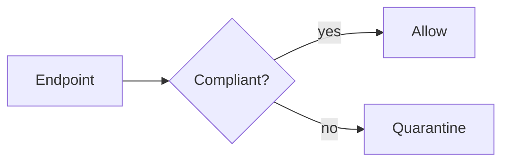

# Quarterly Security Posture Report

> [!NOTE]
> This report was generated from RMM and SIEM exports on **2026-10-20**.

## Executive summary

Overall posture **improved** this quarter. Patch latency dropped from *14.2 days* to *6.8 days*, and
<span style="color:#b42332;font-weight:600">two critical findings</span> remain open.

| Control | Status | Owner | Due |
|:--------|:------:|------:|-----|
| AC.L2-3.1.1 | <span style="color:green">Met</span> | IT Ops | n/a |
| IA.L2-3.5.3 | <span style="background-color:#fff3b0">Partial</span> | Security | 2026-11-30 |
| AU.L2-3.3.1 | ~~Not met~~ Met | SOC | n/a |

### Action items

- [x] Enforce MFA on all privileged accounts
- [ ] Rotate the break-glass credential
  - [ ] Store in the vault
- [ ] Review firewall rules[^fw]

> [!WARNING]
> Two servers still run an unsupported OS.

> [!CAUTION]
> Do not disable logging while remediating.

## Risk score

The weighted score is $R = \sum_{i=1}^{n} w_i s_i$ where weights sum to 1. Budget is $5 to $10 per seat.

$$
R_{\text{adj}} = \frac{R}{1 + e^{-k(t - t_0)}}
$$



```powershell
Get-MpComputerStatus | Select-Object AMServiceEnabled, RealTimeProtectionEnabled
```

```json
{ "tenant": "example", "score": 87.5, "critical": 2 }
```

1. First step
2. Second step
   1. Nested step

Visit https://example.com for details or email <security@example.com>.

<details>
<summary>Raw data</summary>

Hidden detail with `inline code`.

</details>

---

[^fw]: Includes the legacy VPN concentrator.
